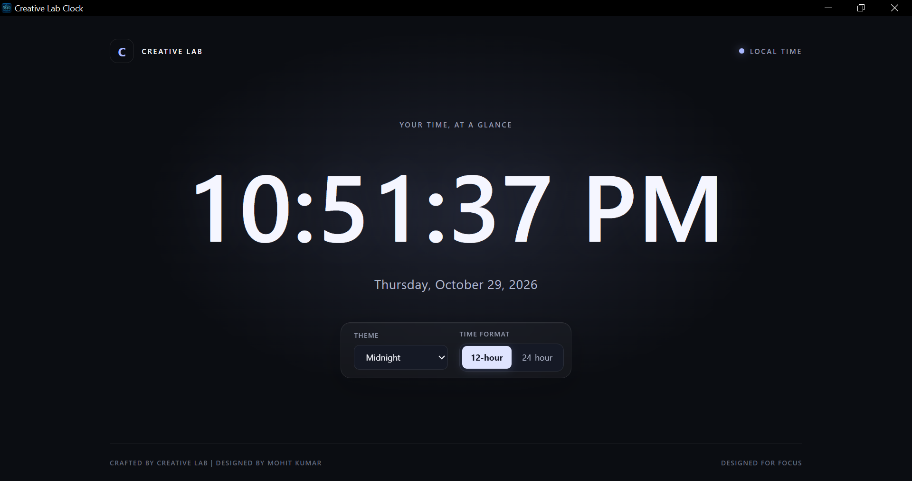
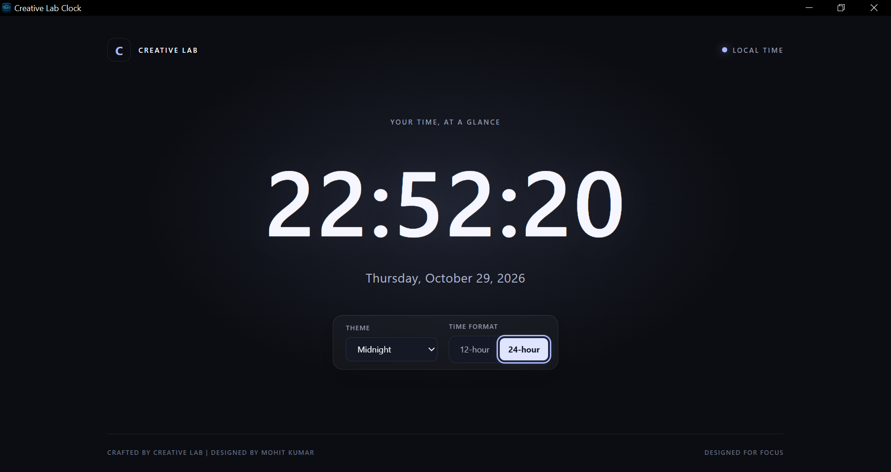
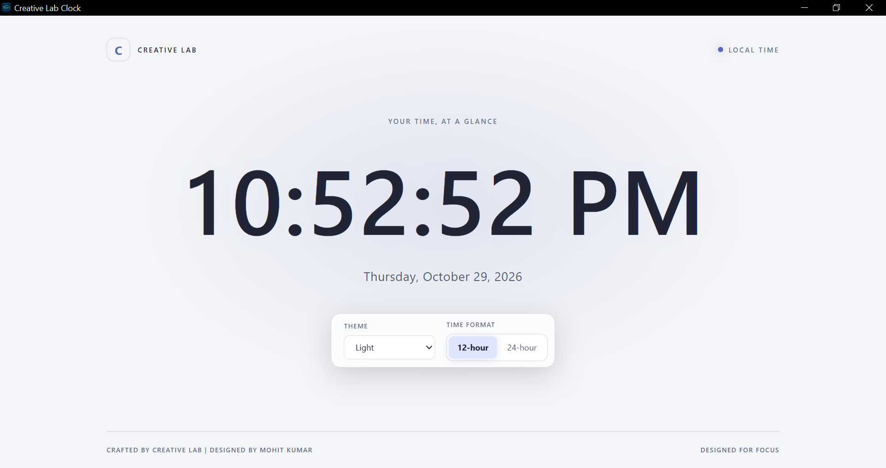
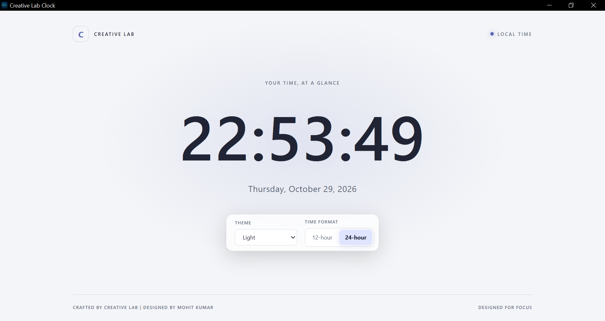
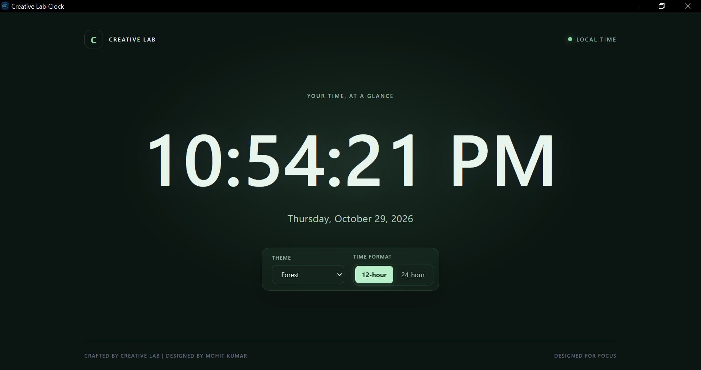
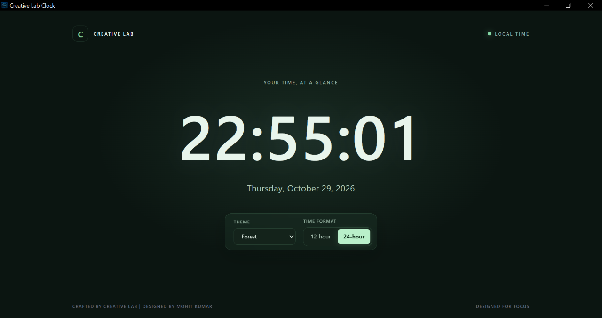

# Creative Lab Clock (C02)

A clean, minimal digital clock built with HTML, CSS, and JavaScript, with a Windows desktop version powered by Electron.

## Features

- Live local time, updated every second
- 12-hour and 24-hour time formats
- Current date with weekday, month, and year
- Three themes: Midnight, Light, and Forest
- Persistent theme and time-format preferences
- Click the clock to switch time formats
- Keyboard support for switching formats
- Responsive interface with accessible controls
- Windows desktop application with a custom app icon

## Screenshots

The clock supports three themes and both 12-hour and 24-hour time formats.

### Midnight





### Light





### Forest





## Tech Stack

- HTML5
- CSS3
- JavaScript
- Node.js
- Electron
- Electron Builder

## Project Structure

```text
digital-clock-02/
├── assets/
├── desktop/
├── src/
│   ├── clock-engine.js
│   ├── clock.js
│   ├── index.html
│   └── styles.css
├── tests/
├── ACCEPTANCE-CRITERIA.md
├── SCOPE.md
├── package.json
└── README.md
```

## Requirements

- Node.js 24.x
- npm 11.x

## Run the Desktop App

From the repository root:

```powershell
npm start --prefix .\components\digital-clock-02
```

## Run Tests

Run the clock-engine tests:

```powershell
npm test --prefix .\components\digital-clock-02
```

## Build the Windows Installer

```powershell
npm run dist --prefix .\components\digital-clock-02
```

The generated Windows installer is placed in:

```text
components/digital-clock-02/release/
```

The installer uses NSIS and allows the user to choose the installation directory.

## Preferences

The browser interface stores the selected theme and time format in `localStorage`, so those preferences persist across reloads in the same browser storage context.

## Project Scope

C02 is the second project in the Creative Lab repository. Refer to `SCOPE.md` and `ACCEPTANCE-CRITERIA.md` for its scope and acceptance requirements.

## Author

**Creative Lab by Mohit Kumar**
