# Beyond — Mobile App Landing Page

A responsive, dark editorial mobile app landing page built with Astro as
part of the Creative Lab web template collection.

Beyond explores an expressive visual direction with bold typography,
near-black surfaces, electric lime accents, and CSS-built mobile app previews.

## Overview

- **Template:** Mobile App 02
- **Project:** Beyond
- **Category:** Web Template / Landing Page
- **Framework:** Astro
- **Rendering:** Static site generation
- **Status:** Completed template; final repository QA in progress

## Design Direction

The visual identity is based on a dark editorial style:

- Near-black backgrounds and elevated dark surfaces
- Electric lime accent (`#D5FF5F`)
- DM Sans and Space Grotesk typography
- Bold headings and asymmetric layouts
- Responsive navigation and section layouts
- CSS-built mobile app interface previews
- Reduced-motion support and visible keyboard focus styles

## Screenshots

### Desktop

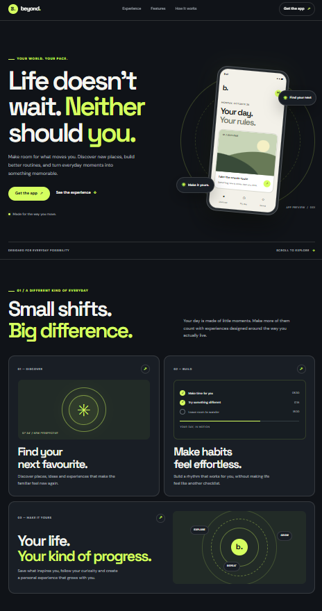

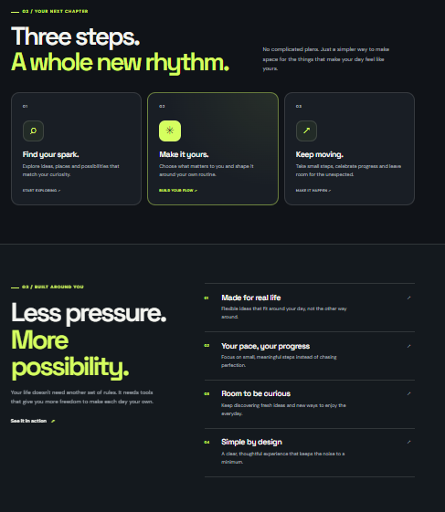

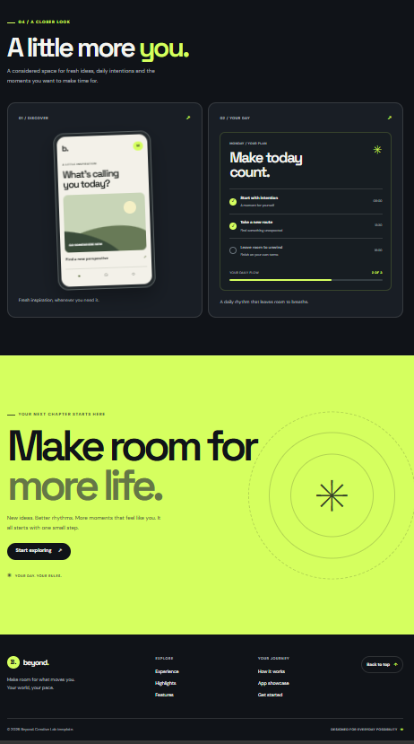

### Mobile

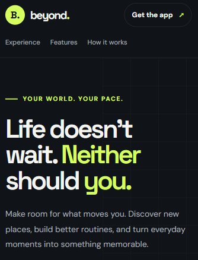

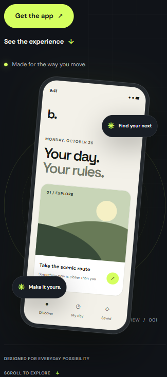

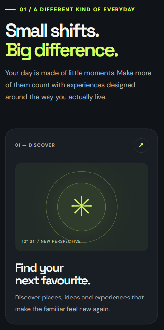

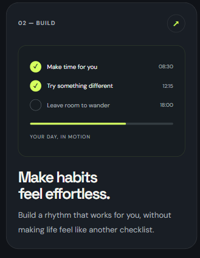

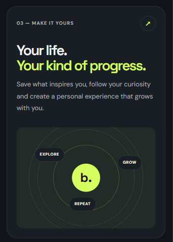

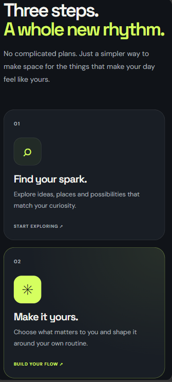

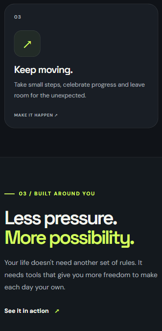

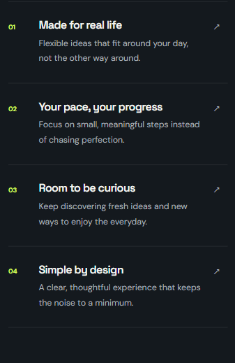

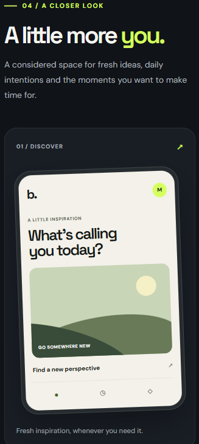

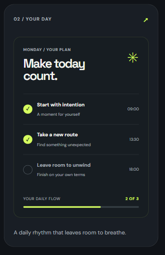

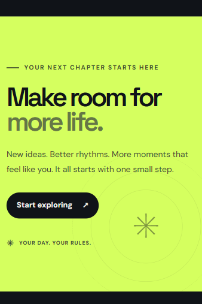

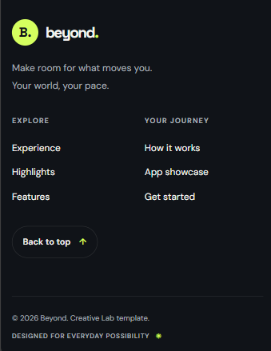

## Features

- Responsive navbar with section navigation
- Hero section with a decorative mobile app preview
- Highlights and feature storytelling
- Three-step "How it works" section
- Benefits list
- App showcase previews
- Final call-to-action section
- Footer with section links
- SEO metadata and social-sharing tags
- Responsive layouts for desktop, tablet, and mobile

## Tech Stack

- Astro
- HTML
- CSS
- JavaScript for Astro tooling
- Google Fonts: DM Sans and Space Grotesk
- Git and GitHub

## Project Structure

```text
mobile-app-02/
├── public/
├── src/
│   ├── components/
│   │   ├── AppShowcase.astro
│   │   ├── Benefits.astro
│   │   ├── FinalCTA.astro
│   │   ├── Footer.astro
│   │   ├── Hero.astro
│   │   ├── Highlights.astro
│   │   ├── HowItWorks.astro
│   │   └── Navbar.astro
│   ├── layouts/
│   │   └── MainLayout.astro
│   ├── pages/
│   │   └── index.astro
│   └── styles/
│       └── global.css
├── astro.config.mjs
├── package.json
└── README.md
```

## Getting Started

### Requirements

- Node.js compatible with the project's Astro version
- npm

### Install dependencies

Run these commands from this directory:

```sh
npm install
```

### Start the development server

```sh
npm run dev
```

Open `http://localhost:4321/` in your browser.

### Create a production build

```sh
npm run build
```

The generated static site is written to `dist/`.

### Preview the production build

```sh
npm run preview
```

Open the local URL printed by Astro to inspect the production build.

## Quality Checks

The template has been tested with:

- Astro production build
- Desktop and mobile responsive inspection
- Keyboard navigation and focus visibility
- Reduced-motion preference
- Lighthouse mobile audit

Latest recorded Lighthouse results:

| Category       | Score |
| -------------- | ----: |
| Performance    |    96 |
| Accessibility  |   100 |
| Best Practices |   100 |
| SEO            |   100 |

Lighthouse scores can vary between runs and environments. Re-run the audit
after significant changes and test the deployed site before release.

## SEO and Deployment Notes

- Update the canonical URL for the final production domain before deployment.
- Supply a real social-sharing image when one is available.
- Verify metadata and links on the deployed website.
- Confirm that the chosen hosting platform supports the generated static site.

## Credits

Built as part of the Creative Lab project collection.

The Beyond brand and interface are used as the concept for this portfolio
template. External font requests are made to Google Fonts.

## License

Refer to the main Creative Lab repository's `LICENSE` file for applicable
usage terms.
